<div align="center">



<br/>

[](https://haytokoraz.github.io/)
[](https://haytokoraz.github.io/extensions.html)
[](https://chromewebstore.google.com/detail/hmblfojhnndofecfffkmamklcpibhbep)
[](https://microsoftedge.microsoft.com/addons/detail/hkhjhlaciakanpanhfckcalfddbgdibf)
[](https://github.com/HaYToKoRaZ?tab=followers)

**I build small tools that actually ship.**
<sub>Browser extensions for Chromium, Helium and Edge · native desktop utilities for Windows and CachyOS Linux · no bloat, no telemetry.</sub>

</div>

---

I'm **HaYTo** — a solo developer who prefers finished software over perfect software that nobody runs.

Every project here follows the same rules: **one job done properly**, **zero telemetry**, **MIT licensed**, and **light enough that you forget it's running**. Everything is published to real stores and real releases — not just commits.

```text
14 shipped products  ·  7 browser extensions  ·  7 desktop apps  ·  100% open source
```

## Browser Extensions

Available on **Chrome Web Store** and **Microsoft Edge Add-ons** · recommended browser: [**Helium**](https://helium.computer/)

| Extension | What it does | Install |
|:--|:--|:--|
| **[RewriteAI](https://haytokoraz.github.io/RewriteAI/)** | Select text anywhere and rewrite it instantly. Bring your own Gemini, Groq, Claude or OpenAI key — fix grammar, change tone, shorten. | [Chrome](https://chromewebstore.google.com/detail/hmblfojhnndofecfffkmamklcpibhbep) · [Edge](https://microsoftedge.microsoft.com/addons/detail/hkhjhlaciakanpanhfckcalfddbgdibf) · [Repo](https://github.com/HaYToKoRaZ/RewriteAI) |
| **[TabSuspender](https://haytokoraz.github.io/TabSuspender-HaYTooL/)** | Puts unused tabs to sleep automatically — up to 85% less RAM, no data loss, no background chatter. | [Chrome](https://chromewebstore.google.com/detail/tabsuspender-haytool/jdobamnoklijnglcdbadcbefhncmnkad) · [Edge](https://microsoftedge.microsoft.com/addons/detail/oiiaihdhfoepcipblaiggcbignahmbeg) · [Repo](https://github.com/HaYToKoRaZ/TabSuspender-HaYTooL) |
| **[XDownloader](https://haytokoraz.github.io/xdownloader-HaYTooL/)** | One-click download of video, photo and GIF media from X (Twitter) at the original quality. | [Chrome](https://chromewebstore.google.com/detail/xdownloader-haytool-x-twi/jnlbcckjheilahbmllldndcgamfahnfb) · [Edge](https://microsoftedge.microsoft.com/addons/detail/ehpcnkiobcjfgnepikdmempghdonipkb) · [Repo](https://github.com/HaYToKoRaZ/xdownloader-HaYTooL) |
| **[WebTranslate](https://haytokoraz.github.io/WebTranslate-HaYTooL/)** | Full-page and selected-text translation with 6 engines, live progress and side-by-side tab comparison. | [Chrome](https://chromewebstore.google.com/detail/webtranslate-haytool/imjenhligglmpnnobmipgafhbhepfebh) · [Edge](https://microsoftedge.microsoft.com/addons/detail/cdpmckcmphjjepmeoflajckbppfnahob) · [Repo](https://github.com/HaYToKoRaZ/WebTranslate-HaYTooL) |
| **[ExtensityPlus](https://haytokoraz.github.io/ExtensityPlus-HaYTooL/)** | Turn extensions on and off in one click. A fast, no-nonsense extension manager. | [Chrome](https://chromewebstore.google.com/detail/mpcogfjfimnlfamonkfelppdcdhfhcom) · [Edge](https://microsoftedge.microsoft.com/addons/detail/dabnojjcohhbhbopbgjaaeajffagiiph) · [Repo](https://github.com/HaYToKoRaZ/ExtensityPlus-HaYTooL) |
| **[Cloud StartPage](https://haytokoraz.github.io/HaYTooL-Cloud-StartPage/)** | A minimal, customisable new-tab page with optional cloud sync for bookmarks and links. | [Chrome](https://chromewebstore.google.com/detail/haytool-cloud-startpage/fgiompioalgpjalpmdjchlgecgdkkncn) · [Edge](https://microsoftedge.microsoft.com/addons/detail/haytool-cloud-startpage/jkefcejfnbeifclgpkfkpidoegohcchp) · [Repo](https://github.com/HaYToKoRaZ/HaYTooL-Cloud-StartPage) |
| **[WhatsApp to Sahibinden](https://chromewebstore.google.com/detail/whatsapp-to-sahibinden/kpgemfhcbfplfinonlfolenclpjmplbd)** | Moves a listing from a WhatsApp message into a formatted Sahibinden ad in seconds. | [Chrome](https://chromewebstore.google.com/detail/whatsapp-to-sahibinden/kpgemfhcbfplfinonlfolenclpjmplbd) · [Edge](https://microsoftedge.microsoft.com/addons/detail/whatsapp-to-sahibinden/kpgemfhcbfplfinonlfolenclpjmplbd) |

## Desktop Apps

Windows · CachyOS Linux · macOS where noted · download the latest build from **Releases**

| App | What it does | Get it |
|:--|:--|:--|
| **[WattCost](https://haytokoraz.github.io/WattCost/)** | Reads real wall power from hardware sensors and turns it into live electricity cost. In-game RTSS overlay, power-plan engine, driver-free telemetry. | [Site](https://haytokoraz.github.io/WattCost/) · [Download](https://github.com/HaYToKoRaZ/WattCost/releases/latest) |
| **[Lol Account Switcher](https://haytokoraz.github.io/Lol-Account-Switcher/)** | Millisecond-level Riot/LoL account switching, 144/240 Hz refresh-rate tuning and in-game config protection. Pure C# .NET, direct Win32, Vanguard-safe. | [Site](https://haytokoraz.github.io/Lol-Account-Switcher/) · [Download](https://github.com/HaYToKoRaZ/Lol-Account-Switcher/releases/latest) |
| **[YouTube Download](https://haytokoraz.github.io/haytool-youtube-download/)** | Follows channels over RSS instead of the algorithm, downloads new uploads in the background, builds an ad-free offline library. | [Site](https://haytokoraz.github.io/haytool-youtube-download/) · [Download](https://github.com/HaYToKoRaZ/haytool-youtube-download/releases/latest) |
| **[Firewall](https://haytokoraz.github.io/HaYTooL-Firewall/)** | Manages Windows Firewall rules as reusable profiles. Recursive folder scan blocks or whitelists thousands of `.exe` files in one click. | [Site](https://haytokoraz.github.io/HaYTooL-Firewall/) · [Download](https://github.com/HaYToKoRaZ/HaYTooL-Firewall/releases/latest) |
| **[FakeLord](https://haytokoraz.github.io/FakeLord/)** | Ghost-process Discord activity simulator — shows 4,000+ games as running with 0 MB GPU load and zero hardware cost. | [Site](https://haytokoraz.github.io/FakeLord/) · [Download](https://github.com/HaYToKoRaZ/FakeLord/releases/latest) |
| **[Weather](https://haytokoraz.github.io/HaYTooL-Weather/)** | Lives quietly in the Windows tray and shows live temperature and conditions through dynamic system-tray icons. | [Site](https://haytokoraz.github.io/HaYTooL-Weather/) · [Download](https://github.com/HaYToKoRaZ/HaYTooL-Weather/releases/latest) |
| **[Wallpaper](https://haytokoraz.github.io/HaYTooL-Wallpaper/)** | Silent dynamic wallpaper engine — rotates high-resolution images on a schedule with zero RAM and CPU footprint. | [Site](https://haytokoraz.github.io/HaYTooL-Wallpaper/) · [Download](https://github.com/HaYToKoRaZ/HaYTooL-Wallpaper/releases/latest) |

## The portfolio itself

**[haytokoraz.github.io](https://haytokoraz.github.io/)** is a working Windows 98 desktop in the browser — My Computer, Notepad, Recycle Bin, start menu, taskbar clock and TR/EN switching. Vanilla HTML, CSS and JavaScript only: no framework, no build step, no dependencies.

**[Open the projects hub →](https://haytokoraz.github.io/extensions.html)** for every extension and app in one place.

<details>
<summary><b>Other repositories</b></summary>

<br/>

- **[haytokoraz.github.io](https://github.com/HaYToKoRaZ/haytokoraz.github.io)** — the retro desktop portfolio above.
- **[caseopening](https://github.com/HaYToKoRaZ/caseopening)** — case-opening web app (PHP, early work).
- **[disktree](https://github.com/HaYToKoRaZ/disktree)** — treemap for finding what fills your disk, for Omarchy (Rust + GPUI). *Fork.*
- **[kernel_xiaomi_sm6150](https://github.com/HaYToKoRaZ/kernel_xiaomi_sm6150)** — Zelo Kernel source for the Redmi Note 10 Pro Max. *Fork.*

</details>

## Stack

<div align="center">


</div>

## In numbers

<div align="center">

[](https://github.com/HaYToKoRaZ?tab=followers)
[](https://github.com/HaYToKoRaZ?tab=repositories)
[](https://github.com/HaYToKoRaZ?tab=repositories)
[](https://haytokoraz.github.io/extensions.html)


<picture>
  <source media="(prefers-color-scheme: dark)" srcset="https://raw.githubusercontent.com/HaYToKoRaZ/HaYToKoRaZ/output/snake.svg" />
  
</picture>

</div>

## How I work

```text
Keep it small.   A tool that does one thing well beats an app that does ten things badly.
Measure it.      Telemetry on your own machine, not on your users. Watts, ms, FPS — numbers, not feelings.
Stay private.    Data stays local. The cloud is optional, never the default.
Finish it.       Unreleased perfect code is code nobody uses.
```

---

<div align="center">

<sub>Modern tech, retro soul · Istanbul, Türkiye</sub>

[**Portfolio**](https://haytokoraz.github.io/) · [**Projects**](https://haytokoraz.github.io/extensions.html) · [**Chrome Web Store**](https://chromewebstore.google.com/detail/hmblfojhnndofecfffkmamklcpibhbep) · [**Steam**](https://steamcommunity.com/id/HaYTo/) · [**X**](https://x.com/HaYTo) · [**Instagram**](https://www.instagram.com/haytokoraz/) · [**Mail**](mailto:korazhayto@gmail.com)

</div>
