

 

**I build small tools that actually ship.**

Browser extensions for Chromium, Helium and Edge · native desktop utilities for Windows and CachyOS Linux · no bloat, no telemetry.

---

I'm **HaYTo** — a solo developer who prefers finished software over perfect software that nobody runs. Every module below is published to a real store or a real release page, not just pushed to a branch: **one job done properly**, **zero telemetry**, **MIT licensed**, and **light enough that you forget it's running**.

Available on **Chrome Web Store** and **Microsoft Edge Add-ons** · recommended browser: [**Helium**](https://helium.computer/)

<table>
<tr>
<td><a href="https://haytokoraz.github.io/RewriteAI/">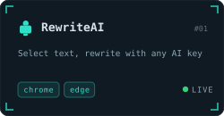</a></td>
<td><a href="https://haytokoraz.github.io/TabSuspender-HaYTooL/">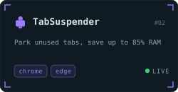</a></td>
<td><a href="https://haytokoraz.github.io/xdownloader-HaYTooL/">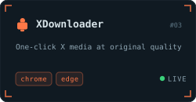</a></td>
</tr>
<tr>
<td><a href="https://haytokoraz.github.io/WebTranslate-HaYTooL/">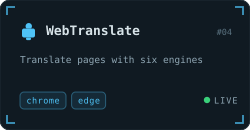</a></td>
<td><a href="https://haytokoraz.github.io/ExtensityPlus-HaYTooL/">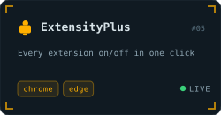</a></td>
<td><a href="https://haytokoraz.github.io/HaYTooL-Cloud-StartPage/">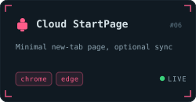</a></td>
</tr>
<tr>
<td><a href="https://chromewebstore.google.com/detail/whatsapp-to-sahibinden/kpgemfhcbfplfinonlfolenclpjmplbd">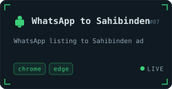</a></td>
<td></td>
<td></td>
</tr>
</table>

<b>Direct install links</b>

 

| Extension | Chrome Web Store | Edge Add-ons | Source |
|:--|:--|:--|:--|
| **[RewriteAI](https://haytokoraz.github.io/RewriteAI/)** | [Chrome](https://chromewebstore.google.com/detail/hmblfojhnndofecfffkmamklcpibhbep) | [Edge](https://microsoftedge.microsoft.com/addons/detail/hkhjhlaciakanpanhfckcalfddbgdibf) | [Repo](https://github.com/HaYToKoRaZ/RewriteAI) |
| **[TabSuspender](https://haytokoraz.github.io/TabSuspender-HaYTooL/)** | [Chrome](https://chromewebstore.google.com/detail/tabsuspender-haytool/jdobamnoklijnglcdbadcbefhncmnkad) | [Edge](https://microsoftedge.microsoft.com/addons/detail/oiiaihdhfoepcipblaiggcbignahmbeg) | [Repo](https://github.com/HaYToKoRaZ/TabSuspender-HaYTooL) |
| **[XDownloader](https://haytokoraz.github.io/xdownloader-HaYTooL/)** | [Chrome](https://chromewebstore.google.com/detail/xdownloader-haytool-x-twi/jnlbcckjheilahbmllldndcgamfahnfb) | [Edge](https://microsoftedge.microsoft.com/addons/detail/ehpcnkiobcjfgnepikdmempghdonipkb) | [Repo](https://github.com/HaYToKoRaZ/xdownloader-HaYTooL) |
| **[WebTranslate](https://haytokoraz.github.io/WebTranslate-HaYTooL/)** | [Chrome](https://chromewebstore.google.com/detail/webtranslate-haytool/imjenhligglmpnnobmipgafhbhepfebh) | [Edge](https://microsoftedge.microsoft.com/addons/detail/cdpmckcmphjjepmeoflajckbppfnahob) | [Repo](https://github.com/HaYToKoRaZ/WebTranslate-HaYTooL) |
| **[ExtensityPlus](https://haytokoraz.github.io/ExtensityPlus-HaYTooL/)** | [Chrome](https://chromewebstore.google.com/detail/mpcogfjfimnlfamonkfelppdcdhfhcom) | [Edge](https://microsoftedge.microsoft.com/addons/detail/dabnojjcohhbhbopbgjaaeajffagiiph) | [Repo](https://github.com/HaYToKoRaZ/ExtensityPlus-HaYTooL) |
| **[Cloud StartPage](https://haytokoraz.github.io/HaYTooL-Cloud-StartPage/)** | [Chrome](https://chromewebstore.google.com/detail/haytool-cloud-startpage/fgiompioalgpjalpmdjchlgecgdkkncn) | [Edge](https://microsoftedge.microsoft.com/addons/detail/haytool-cloud-startpage/jkefcejfnbeifclgpkfkpidoegohcchp) | [Repo](https://github.com/HaYToKoRaZ/HaYTooL-Cloud-StartPage) |
| **[WhatsApp to Sahibinden](https://chromewebstore.google.com/detail/whatsapp-to-sahibinden/kpgemfhcbfplfinonlfolenclpjmplbd)** | [Chrome](https://chromewebstore.google.com/detail/whatsapp-to-sahibinden/kpgemfhcbfplfinonlfolenclpjmplbd) | [Edge](https://microsoftedge.microsoft.com/addons/detail/whatsapp-to-sahibinden/kpgemfhcbfplfinonlfolenclpjmplbd) | — |

Windows · CachyOS Linux · download the latest build from **Releases**

<table>
<tr>
<td><a href="https://haytokoraz.github.io/WattCost/">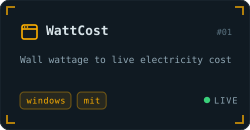</a></td>
<td><a href="https://haytokoraz.github.io/Lol-Account-Switcher/">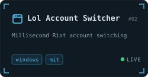</a></td>
<td><a href="https://haytokoraz.github.io/haytool-youtube-download/">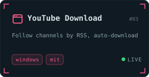</a></td>
</tr>
<tr>
<td><a href="https://haytokoraz.github.io/HaYTooL-Firewall/">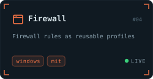</a></td>
<td><a href="https://haytokoraz.github.io/FakeLord/">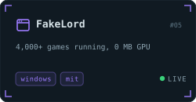</a></td>
<td><a href="https://haytokoraz.github.io/HaYTooL-Weather/">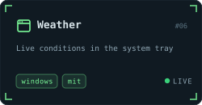</a></td>
</tr>
<tr>
<td><a href="https://haytokoraz.github.io/HaYTooL-Wallpaper/">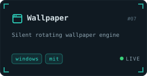</a></td>
<td><a href="https://github.com/HaYToKoRaZ/DiskHaY">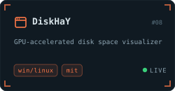</a></td>
<td><a href="https://haytokoraz.github.io/">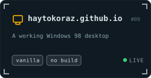</a></td>
</tr>
</table>

<b>Downloads and source</b>

 

| App | Project site | Latest release |
|:--|:--|:--|
| **WattCost** | [Site](https://haytokoraz.github.io/WattCost/) | [Download](https://github.com/HaYToKoRaZ/WattCost/releases/latest) |
| **Lol Account Switcher** | [Site](https://haytokoraz.github.io/Lol-Account-Switcher/) | [Download](https://github.com/HaYToKoRaZ/Lol-Account-Switcher/releases/latest) |
| **YouTube Download** | [Site](https://haytokoraz.github.io/haytool-youtube-download/) | [Download](https://github.com/HaYToKoRaZ/haytool-youtube-download/releases/latest) |
| **Firewall** | [Site](https://haytokoraz.github.io/HaYTooL-Firewall/) | [Download](https://github.com/HaYToKoRaZ/HaYTooL-Firewall/releases/latest) |
| **FakeLord** | [Site](https://haytokoraz.github.io/FakeLord/) | [Download](https://github.com/HaYToKoRaZ/FakeLord/releases/latest) |
| **Weather** | [Site](https://haytokoraz.github.io/HaYTooL-Weather/) | [Download](https://github.com/HaYToKoRaZ/HaYTooL-Weather/releases/latest) |
| **Wallpaper** | [Site](https://haytokoraz.github.io/HaYTooL-Wallpaper/) | [Download](https://github.com/HaYToKoRaZ/HaYTooL-Wallpaper/releases/latest) |
| **DiskHaY** | [Repo](https://github.com/HaYToKoRaZ/DiskHaY) | [Download](https://github.com/HaYToKoRaZ/DiskHaY/releases/latest) |

<b>Other repositories</b>

 

- **[haytokoraz.github.io](https://github.com/HaYToKoRaZ/haytokoraz.github.io)** — the Windows 98 desktop portfolio above. Vanilla HTML, CSS and JavaScript: no framework, no build step, no dependencies.
- **[caseopening](https://github.com/HaYToKoRaZ/caseopening)** — case-opening web app (PHP, early work).
- **[disktree](https://github.com/HaYToKoRaZ/disktree)** — treemap for finding what fills your disk, for Omarchy (Rust + GPUI). *Fork.*
- **[kernel_xiaomi_sm6150](https://github.com/HaYToKoRaZ/kernel_xiaomi_sm6150)** — Zelo Kernel source for the Redmi Note 10 Pro Max. *Fork.*

 

<picture>
  <source media="(prefers-color-scheme: dark)" srcset="https://raw.githubusercontent.com/HaYToKoRaZ/HaYToKoRaZ/output/snake.svg" />
  
</picture>

 
 

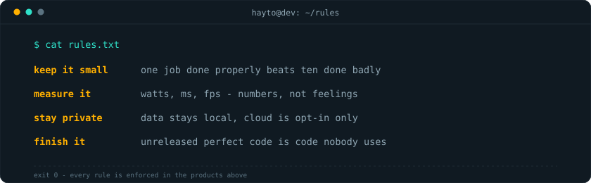

---

Modern tech, retro soul · Istanbul, Türkiye

[**Portfolio**](https://haytokoraz.github.io/) · [**Projects**](https://haytokoraz.github.io/extensions.html) · [**Chrome Web Store**](https://chromewebstore.google.com/detail/hmblfojhnndofecfffkmamklcpibhbep) · [**Steam**](https://steamcommunity.com/id/HaYTo/) · [**X**](https://x.com/HaYTo) · [**Instagram**](https://www.instagram.com/haytokoraz/) · [**Mail**](mailto:korazhayto@gmail.com)

